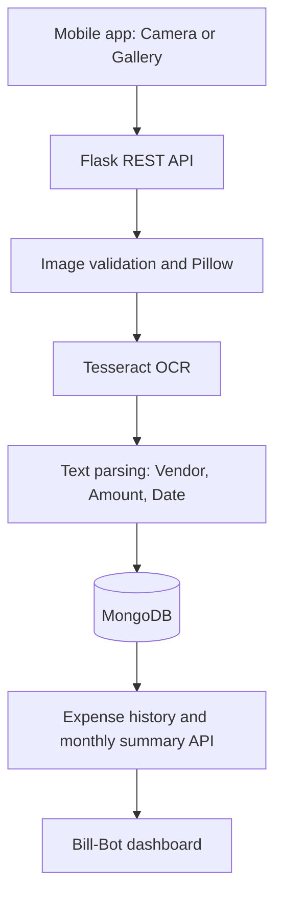

# Bill-Bot
# Bill-Bot — Smart Bill Scanning & Expense Tracker

Bill-Bot is a mobile expense-tracking application that simplifies the process of recording everyday purchases. Users can capture a bill with their device camera or select an image from their gallery. The application sends the image to a Python backend, extracts key bill information using Optical Character Recognition (OCR), and stores the processed record in MongoDB.

The mobile dashboard displays recent expenses, the current month's spending total, and a vendor-wise spending summary. The project was developed as a **2025 Summer Internship Project**.

> **Implementation note:** The current backend uses Tesseract OCR and rule-based text parsing. It does not use a generative AI model yet. Extracted values should be reviewed for accuracy, especially when bill images are unclear or use unusual layouts.

## Key Features

- **Bill image capture:** Capture a bill using the device camera or choose an existing image from the gallery.
- **OCR-based extraction:** Extract text from uploaded bill images using Tesseract OCR.
- **Bill information parsing:** Identify the vendor, bill amount, and transaction date from the extracted text.
- **Expense storage:** Save processed bill records in MongoDB.
- **Expense history:** Retrieve and display recently added bills.
- **Monthly spending summary:** Calculate the current month's spending and group expenses by vendor.
- **Spending insight:** Display a basic spending observation based on the leading vendor in the monthly summary.
- **Cross-platform frontend:** Built with Expo and React Native, with Android, iOS, and web development targets configured.

## Technology Stack

| Layer | Technology | Responsibility |
|---|---|---|
| Mobile application | React Native, Expo SDK 53, Expo Router, TypeScript | User interface, navigation, camera/gallery access |
| API backend | Python, Flask, Flask-CORS | REST API and bill processing workflow |
| Image handling | Pillow (PIL) | Opening uploaded images and converting them to RGB |
| OCR | Tesseract OCR, `pytesseract` | Extracting text from bill images |
| Data parsing | Python regular expressions | Identifying vendor, amount, and date values |
| Database | MongoDB, Flask-PyMongo, PyMongo | Persisting and retrieving bill records |
| Frontend HTTP client | Axios | Communicating with the backend API |

## How It Works

1. The user captures a bill using the camera or selects an image from the device gallery.
2. The React Native application uploads the image to the Flask API using a multipart form-data request.
3. The backend validates the image file, saves it temporarily in the `backend/uploads/` directory, and opens it with Pillow.
4. Tesseract OCR extracts the text present in the bill image.
5. The backend applies parsing rules to identify the vendor, amount, and date.
6. The extracted information and supporting metadata are saved as a document in MongoDB.
7. The frontend refreshes the expense history and monthly summary using the backend API.



## Repository Structure

```text
Bill-Bot/
├── backend/
│   ├── app.py                         # Flask API, OCR processing, and MongoDB operations
│   └── uploads/                       # Created automatically for uploaded bill images
│
├── frontend/
│   ├── app/
│   │   ├── _layout.tsx                # Root navigation layout
│   │   └── (tabs)/
│   │       ├── _layout.tsx            # Tab navigation
│   │       ├── index.tsx              # Main expense dashboard
│   │       ├── explore.tsx            # Secondary Expo starter screen
│   │       └── services/
│   │           └── apiService.ts      # Axios API integration and backend URL
│   ├── app.json                       # Expo application configuration
│   └── package.json                  # Frontend dependencies and scripts
│
├── .gitignore
├── LICENSE
└── README.md
```

## Prerequisites

Install the following before setting up the project:

- **Git** — to clone the repository.
- **Python 3.10 or later** — to run the backend. (The repository does not currently pin a Python version.)
- **Node.js 20.18 or later and npm** — the frontend uses Expo SDK 53.
- **MongoDB Community Server** — running locally or available through a MongoDB connection URI.
- **Tesseract OCR** — the OCR engine used by `pytesseract`. Installing the Python package alone is not sufficient; the Tesseract executable must also be installed and accessible on the system `PATH`.
- **Expo Go or an emulator/simulator** — to run and test the mobile application. Android Studio is needed for an Android emulator; Xcode is needed for an iOS simulator on macOS.

Useful installation references:

- [Python](https://www.python.org/downloads/)
- [Node.js](https://nodejs.org/en/download/)
- [MongoDB Community Server](https://www.mongodb.com/try/download/community)
- [Tesseract OCR](https://github.com/tesseract-ocr/tesseract)
- [Expo documentation](https://docs.expo.dev/)

## Local Setup and Installation

The backend and frontend run as separate processes. Keep them running in separate terminal windows during development.

### 1. Clone the Repository

```bash
git clone https://github.com/santhos-13/Bill-Bot.git
cd Bill-Bot
```

### 2. Set Up MongoDB

Start your local MongoDB service and confirm that it is listening on the default port `27017`.

The backend uses the following default database connection:

```text
mongodb://localhost:27017/billtrackerdb
```

MongoDB creates the database and the `bills` collection when the application first writes a bill record. To use MongoDB Atlas or another MongoDB server, use its connection URI in the backend environment configuration in the next step.

### 3. Set Up the Backend

Open a terminal and move into the backend directory:

```bash
cd backend
```

Create and activate a Python virtual environment.

**Windows (PowerShell):**

```powershell
py -m venv .venv
.\.venv\Scripts\Activate.ps1
```

**macOS / Linux:**

```bash
python3 -m venv .venv
source .venv/bin/activate
```

Install the backend dependencies:

```bash
python -m pip install --upgrade pip
pip install Flask Flask-Cors Flask-PyMongo pymongo python-dotenv Pillow pytesseract
```

> The repository currently does not include a backend `requirements.txt`; the command above installs the Python packages imported by `backend/app.py`.

Create a file named `.env` inside the `backend/` directory:

```env
MONGO_URI=mongodb://localhost:27017/billtrackerdb
```

Change `MONGO_URI` when using a remote MongoDB instance. Keep credentials and other secrets out of source control.

#### Verify Tesseract OCR

Open a terminal and run:

```bash
tesseract --version
```

If the command is not recognized, install Tesseract and add its installation directory to your system `PATH`.

On Windows, if Tesseract is installed but `pytesseract` still cannot locate it, open `backend/app.py` and set the executable path near the Tesseract configuration comment. For example:

```python
pytesseract.pytesseract.tesseract_cmd = r"C:\Program Files\Tesseract-OCR\tesseract.exe"
```

#### Start the Backend API

Make sure MongoDB is running, then run the following command from the `backend/` directory:

```bash
python app.py
```

The backend will be available at:

```text
http://localhost:5000
```

You can check that the API is running by opening `http://localhost:5000/` in a browser. It returns a JSON message describing the available endpoints.

### 4. Configure the Frontend API URL

The frontend currently defines its backend URL directly in this file:

```text
frontend/app/(tabs)/services/apiService.ts
```

Open the file and update the `API_URL` constant to point to the computer running the Flask backend. The repository currently contains a development-specific IP address, so this step is required when running the project on another machine.

Choose the appropriate address for your environment:

| Where the frontend is running | Example API URL |
|---|---|
| Web browser on the same computer | `http://127.0.0.1:5000/api` |
| iOS simulator | `http://127.0.0.1:5000/api` |
| Android Studio emulator | `http://10.0.2.2:5000/api` |
| Physical Android/iOS device | `http://<YOUR_COMPUTER_LAN_IP>:5000/api` |

For a physical device, connect the phone and development computer to the same Wi-Fi network, replace the placeholder with the computer's local network IP address, and ensure the computer's firewall allows inbound connections on port `5000`.

For example, the configuration should look like this:

```typescript
const API_URL = 'http://192.168.1.10:5000/api'; // Replace with your computer's LAN IP
```

Do not use the example IP unless it is actually assigned to your computer. The backend is configured to listen on `0.0.0.0`, which allows devices on the local network to reach it when network and firewall settings permit.

### 5. Install and Start the Frontend

Open a second terminal from the repository root and run:

```bash
cd frontend
npm install
npx expo start
```

Expo starts the development server and displays a QR code and available launch options.

- **Physical Android/iOS device:** Open the project with Expo Go, where supported by the installed Expo SDK, and scan the QR code.
- **Android emulator:** Start an Android emulator, then press `a` in the Expo terminal.
- **iOS simulator:** On macOS with Xcode installed, start an iOS simulator, then press `i`.
- **Web browser:** Press `w` to launch the web target.

The frontend scripts also include the following commands:

```bash
npm run android   # Start the Android target
npm run ios       # Start the iOS target
npm run web       # Start the web target
npm run lint      # Run Expo ESLint checks
```

### 6. Run the Complete Application

Confirm that both services are running:

| Component | Command | Default address |
|---|---|---|
| Backend | `python app.py` (from `backend/`) | `http://localhost:5000` |
| Frontend | `npx expo start` (from `frontend/`) | Expo development server |
| MongoDB | Start your MongoDB service | `mongodb://localhost:27017` |

Open the application on your selected device or simulator. Use **Scan New Bill** to capture a bill or select an image, then confirm that the processed bill appears in the recent expenses list and that the monthly summary updates.

## Backend API Reference

The Flask backend currently exposes the following endpoints:

| Method | Endpoint | Description |
|---|---|---|
| `GET` | `/` | Returns a welcome message and a list of API routes. |
| `POST` | `/api/upload_bill` | Accepts a bill image, runs OCR, parses bill fields, and stores the record. |
| `GET` | `/api/bills` | Returns stored bills. Supports `limit` and `sort` query parameters. |
| `GET` | `/api/bills/monthly` | Returns the current month's total spending and a vendor-wise breakdown. |

### Upload a Bill

Send a `multipart/form-data` request with the image in a field named `image`:

```bash
curl -X POST http://localhost:5000/api/upload_bill \
  -F "image=@/path/to/your-bill.jpg"
```

The backend accepts `.png`, `.jpg`, `.jpeg`, `.gif`, `.bmp`, and `.tiff` image files. The maximum upload size is 16 MB.

### Retrieve Bills

```bash
# Return up to 50 bills, newest first (default)
curl "http://localhost:5000/api/bills"

# Return up to 20 bills, oldest first
curl "http://localhost:5000/api/bills?limit=20&sort=asc"
```

### Retrieve the Monthly Summary

```bash
curl http://localhost:5000/api/bills/monthly
```

The response includes `monthly_total` and `breakdown_by_vendor` fields.

## Data Model and Extraction Notes

Each saved bill document contains fields similar to the following:

| Field | Description |
|---|---|
| `_id` | MongoDB document identifier, returned by the API as a string. |
| `vendor` | Vendor name inferred from the first meaningful OCR text line. |
| `amount` | Highest positive amount found by the configured amount-matching patterns. |
| `date` | Parsed bill date; falls back to the current date if no supported date is found. |
| `raw_text` | A truncated portion of the OCR text retained for reference. |
| `filename` | Name assigned to the uploaded image. |
| `created_at` | Timestamp when the bill record was created. |

The current parser is heuristic-based. It is intended as a practical starting point, not a universal receipt-understanding engine. OCR output can vary with image quality, lighting, orientation, fonts, and receipt formats. The extracted vendor, amount, and date may therefore require validation before being used for financial reporting.

## Troubleshooting

| Issue | What to check |
|---|---|
| `tesseract is not installed` or executable not found | Install the Tesseract OCR engine, verify `tesseract --version`, and configure its executable path if needed. |
| Backend cannot connect to MongoDB | Confirm MongoDB is running, check port `27017`, and verify `MONGO_URI` in `backend/.env`. |
| Frontend displays a network error | Confirm the backend is running and that `API_URL` in `apiService.ts` uses the correct emulator, simulator, or LAN address. |
| A physical phone cannot reach the backend | Put the phone and computer on the same Wi-Fi network and check firewall rules for port `5000`. |
| No text is extracted from a bill | Try a sharper, well-lit, upright image with readable printed text. |
| The extracted amount or date is incorrect | Review the bill image and account for the current rule-based parsing limitations described above. |
| Expo reports a dependency or SDK mismatch | Use a Node.js version compatible with Expo SDK 53 and consult the Expo SDK 53 documentation before changing package versions. |

## Development Notes and Limitations

- The frontend API base URL is currently hard-coded in `apiService.ts`; update it for each development environment.
- The backend dependency list is not yet captured in a `requirements.txt` file.
- The current implementation extracts bill-level information (vendor, amount, and date); it does not parse individual line items.
- The amount parser selects the highest matching positive amount, which may not always correspond to the final payable total.
- The backend has development-oriented settings and does not implement user authentication or production-grade deployment hardening. Do not expose it publicly or use it as-is for production financial data.

## License

This project is licensed under the [MIT License](LICENSE).

## Author

**Santhosh** — [GitHub Profile](https://github.com/santhos-13)

---

Developed as a **2025 Summer Internship Project**.
